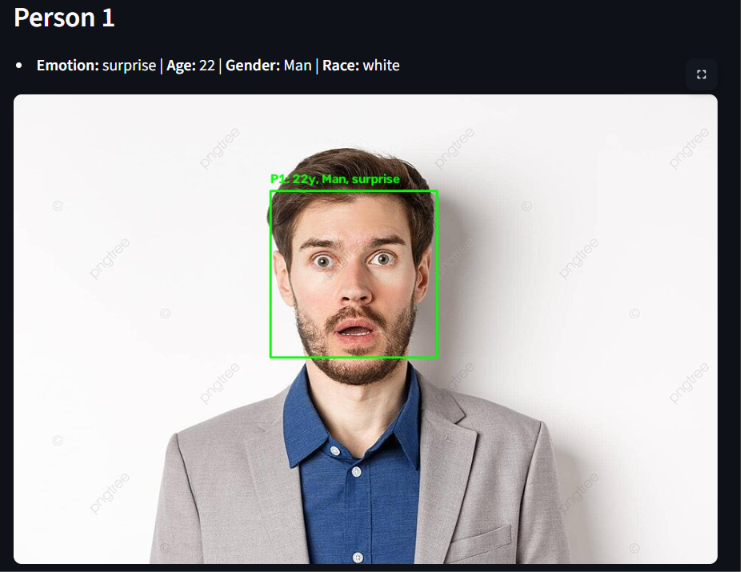

# DeepFace Multi-Face Visual Analysis

## Overview
A Computer Vision application built using Python, DeepFace, OpenCV, and Streamlit.

This application detects multiple faces in an uploaded image and performs facial analysis on each detected face.

## Application Screenshots

### Application Interface


### Multi-Face Analysis Results


## Features
- Multi-face detection.
- Emotion analysis.
- Age estimation.
- Gender classification.
- Race classification.
- Bounding boxes around detected faces.
- Interactive web interface using Streamlit.

## Technologies
- Python
- DeepFace
- OpenCV
- NumPy
- Pillow
- Streamlit

## Installation

Clone the repository:

```bash
git clone YOUR_REPOSITORY_URL
```

Install dependencies:

```bash
pip install -r requirements.txt
```

## Run the Application

```bash
streamlit run app.py
```

Upload an image containing one or more faces to start the analysis.

## Project Structure

```text
DeepFace-Multi-Face-Analysis/
│
├── app.py
├── requirements.txt
├── README.md
└── .gitignore
```

## Disclaimer
All facial analysis results are model predictions and may be inaccurate. They should not be treated as verified facts about individuals.

## Author
Ebrahim Magdy

GitHub: [ebrahim-magdy](https://github.com/ebrahim-magdy)
